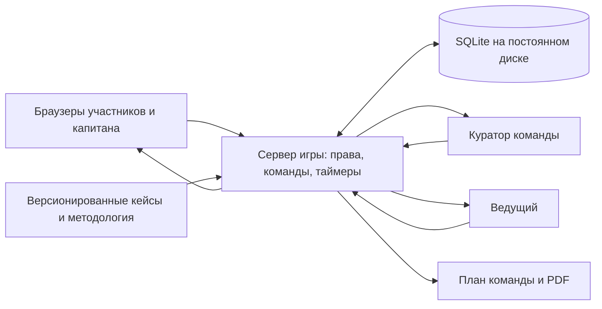

# «Управляй изменением» — проект игры на согласование

Дата: 12 ноября 2026. Статус: предложение до реализации. Продуктовый код не создавался.

## Основание и границы

Совместная обучающая игра для 20 участников, 2–3 команд, одного ведущего и куратора-помощника в каждой команде. Обсуждение — в комнатах Microsoft Teams, работа над общим планом — в браузере. Один кейс занимает 30 минут. Можно пройти оба кейса последовательно либо назначить командам разные кейсы. Результат — первоначальный план изменения, вопросы для ЦЭИ и материал для общего обсуждения.

Игра не выставляет баллы, не ранжирует команды и не объявляет управленческие решения объективно правильными. Индикатор показывает заполненность и состояние обсуждения. Юридические и финансовые условия учебных кейсов отмечаются как вопросы для проверки, а не как установленные факты.

Изученные источники:

| Обозначение | Материал | Что используется |
|---|---|---|
| М1 | `Внедрение_изменений_в_проектах_и_процессах_HR _v3.pdf`, 7 страниц | Пять шагов пилота, роль ЦЭИ, ожидания от спонсора, метрики результата, поведения и восприятия |
| М2 | `Старт пилота — управление изменениями в HR (встреча с руководителями) [Автосохраненный].pptx`, 15 слайдов, включая заметки | Критерии применимости, четыре этапа, три маршрута, роли, подготовка руководителей, поддержка и мониторинг |
| М3 | `Пространство_изменений_MVP.html` | Структура шаблонов плана, коммуникаций, стейкхолдеров, рисков и обратной связи; расхождения описаны ниже |
| ТЗ | Присланное техническое задание | Формат игры, оба кейса, шесть экранов, права участников, ограничения и критерии приёмки |

Проверено состояние GitHub на момент подготовки: `hr-change-game`, коммит `a76f252bca06fb233574827a8ef6bf6a2dd7a4d7`, содержит README и три перечисленных материала. HTML — офлайн-справочник с реестром в localStorage, без общего сервера. В `hr-feedback-survey`, коммит `39edc1981c0524504149800d82ab4a6e8075544e`, есть только README; исходного приложения опросов сейчас нет. Поэтому техническую интеграцию с действующими опросами проверить невозможно. Новую игру предлагается разместить в `hr-change-game`; существующие материалы и репозиторий опросов сохраняются.

## 1. Архитектура и варианты

Рекомендуется отдельное приложение с интерфейсом игры, одним сервером и постоянной базой. Игра — отдельный модуль `/games/change`, пригодный для последующего включения в общую систему. Реальная синхронизация обязательна уже в первой версии.

| Вариант | Преимущества | Ограничения | Предложение |
|---|---|---|---|
| Один сервер Node.js и SQLite на постоянном диске | Достаточно для 20 участников; единое место проверки прав; нет внешней базы и отдельной регистрации | Нужен хостинг с серверным процессом, HTTPS и постоянным диском; одна активная копия сервера | Рекомендуется для MVP |
| Приложение и управляемая PostgreSQL с подписками на обновления | Удобнее масштабировать и запускать несколько серверов | Нужны внешний сервис, настройки доступа и секреты | Возможный следующий этап |
| Модуль внутри действующего сервиса опросов | Общая инфраструктура и администрирование | В доступном `hr-feedback-survey` нет исходного сервиса | Отложить до появления исходников |

Предлагаемый стек, выбор автора проекта для согласования: React + TypeScript + Vite; Node.js 24 LTS + Express; Socket.IO для обновлений; SQLite через встроенный `node:sqlite`; Zod для проверки входящих данных; Vitest и Playwright для проверок. PDF — серверное формирование из единой модели плана с встроенным шрифтом, поддерживающим кириллицу. Вариант библиотеки экспорта и детали сборки оставляются разработчику, с обязательной проверкой реального PDF.

Связь компонентов:

Сервер сохраняет изменение в транзакции и только затем рассылает подтверждённое состояние. У каждого плана есть версия; изменения капитана и куратора передаются с ожидаемой версией. При конфликте приложение показывает обновлённое поле и предлагает повторить решение, не заменяя его молча. Повторная отправка одного запроса не создаёт дублей.

После перезагрузки или восстановления соединения браузер получает актуальное состояние сервера. Индикаторы «сохранено», «отправляется», «нет связи» различаются. При потере связи окончательное решение не помечается сохранённым; текст незавершённого ввода можно временно удерживать локально. Источником общего плана остаётся сервер.

Основные сущности: сессия, команда, раунд команды, назначенный кейс, подключение с ролью, версия плана, предложения, комментарии, показанные подсказки, событие и реакция, решения куратора, журнал изменений. Данные команд и раундов изолированы. Новый раунд создаёт отдельный план и сохраняет предыдущий.

Открытая сессия фиксирует версию кейса и методологии. Редактирование организатором текстов, списка ролей, вариантов и подсказок действует для новых раундов; изменение текущего раунда требует отдельного осознанного действия с сохранением истории. Расширенная система создания произвольных игр в MVP не входит.

### Доступ и права

Участникам не нужны аккаунты. Ведущий получает защищённый доступ организатора; конкретный способ настройки секрета задаётся при развёртывании. Обычная ссылка входа не выдаёт права ведущего.

| Роль | Разрешения |
|---|---|
| Участник | Читать план только своей команды; отправлять предложения; видеть ответы и предложения; открывать общие подсказки |
| Капитан | Всё доступное участнику; принимать, отклонять и объединять предложения; фиксировать ответы команды |
| Куратор команды | Читать и комментировать свою команду; открывать пояснения; фиксировать ответ после обсуждения; принимать обоснованную альтернативу с пояснением |
| Ведущий | Создавать сессию; задавать 2–3 команды и длительность; выдавать роли; назначать кейсы; запускать, приостанавливать и завершать раунды; запускать события; видеть и экспортировать все результаты |

Участник входит по командной ссылке или коду, указывает короткое имя по желанию. Код даёт только участие в конкретной команде. Для капитана, куратора и ведущего выдаются отдельные случайные ссылки-приглашения с достаточной длиной секрета. Сервер обменивает приглашение на сессионный доступ и проверяет роль при каждом чтении и изменении; выбор роли в интерфейсе не меняет права. Ведущий может отозвать приглашение и назначить нового капитана; у команды один действующий капитан. Сессионные данные защищаются средствами браузера, привилегированные приглашения не включаются в PDF и журналы.

Ведущий видит данные всех команд, но не подменяет их содержательные ответы: при необходимости просит капитана или куратора зафиксировать решение. Все действия куратора с окончательными ответами видны команде. Куратор-помощник воркшопа и спонсор изменения внутри кейса — отдельные понятия и подписи.

## 2. Экраны

До игровых экранов: ведущий создаёт сессию; команды входят в ожидание; капитан и куратор проверяют свои роли. Карточка команды показывает назначенный кейс и подключённых участников. Присоединиться можно и после старта.

| Экран | Основные элементы | Что сохраняется |
|---|---|---|
| 1. Получена инициатива | Было / стало, причина, затронутые группы; карточки цели и результата; короткое уточнение | Цель, ожидаемый результат, изменение условий или поведения |
| 2. Оценка изменения | Момент уведомления ЦЭИ, чек-лист, масштаб и отдельный маршрут; краткое обоснование | Ответы по критериям и версия правил, вывод команды, масштаб, маршрут |
| 3. Кто участвует? | Карта ролей; для каждой — зачем, этап, действие; три учебных кандидата в спонсоры | Инициатор, спонсор и его полномочия, карта участников |
| 4. Собери план внедрения | Пять вкладок: подготовка, коммуникации, риски, поддержка, метрики | Согласованный план; незаполненные элементы и открытые вопросы |
| 5. Неожиданное событие | Событие по кейсу; связанный риск или пробел; переход к нужному блоку | Реакция команды, дополнение плана, комментарий куратора |
| 6. Наш план готов | Единая карточка из 13 разделов; вопросы для ЦЭИ; экспорт | Снимок результата и PDF |

Общие элементы: таймер, шаги раунда, статус соединения и сохранения, предложения команды, комментарии куратора, три кнопки помощи. Карточки заменяют длинные анкеты; короткий текст нужен только для обоснования и конкретизации. Управление доступно клавиатурой, состояние не передаётся только цветом, анимации можно сократить.

Индикатор различает «есть ответ», «нужно обсудить», «принято командой» и «альтернатива подтверждена куратором». Полнота не называется качеством решения. Даже частично заполненный план доступен в результате и экспорте с явными пробелами.

Панель ведущего показывает команды, кейсы, время, текущий экран, заполненность, связь, нерешённые вопросы и запросы помощи. Панель куратора — план одной команды, предложения, комментарии и принятые альтернативы. По итогам ведущий видит, на каких заданиях открывали объяснения и оставались вопросы; это сигналы для обсуждения, не рейтинг участников.

## 3. Сценарий 30-минутного раунда

| Время | Действие | Ожидаемый результат |
|---|---|---|
| 0–3 мин | Экран 1: прочитать изменение и сформулировать цель | Общее понимание задачи |
| 3–7 мин | Экран 2: ЦЭИ, применимость, масштаб и маршрут | Первичная оценка и обоснование маршрута |
| 7–11 мин | Экран 3: участники и спонсор | Минимальная карта ролей и полномочий |
| 11–23 мин | Экран 4: собрать план, ориентир 2–3 минуты на блок | План коммуникаций, рисков, поддержки и оценки результата |
| 23–27 мин | Экран 5: событие и доработка | Проверка плана на реалистичную ситуацию |
| 27–30 мин | Экран 6: проверить результат и вопросы для ЦЭИ | План для общего обсуждения |

Время по экранам — рекомендация, не запрет возврата. Таймер определяется сервером. Ведущий запускает все команды вместе или управляет раундами отдельных команд, ставит на паузу и продлевает время. При паузе остаток времени сохраняется; после перезапуска сервера отсчёт восстанавливается из записанных временных отметок.

По умолчанию событие открывается за 7 минут до завершения; ведущий может запустить его раньше. Если команда ещё не дошла до пятого экрана, появляется уведомление без потери текущего ввода. Повторная доставка сообщения не запускает событие второй раз.

В конце времени сохраняется результат и открывается режим просмотра. Незавершённый текст, не подтверждённый сервером, не включается как окончательное решение. Ведущий может продлить или вновь открыть раунд с записью действия. Повторное прохождение второго кейса создаёт новый раунд без очистки первого.

## 4. Наполнение кейсов

### Кейс 1. Премирование

**Было:** премия 20% раз в квартал. **Стало:** 10% раз в год. **Охват:** вся компания. **Причина:** в ТЗ конкретная бизнес-причина не дана; карточка прямо предлагает уточнить обоснование у инициатора. Нельзя автоматически подставить «повышение эффективности» или «экономию» как установленную причину.

Решение руководства предполагается принятым; юридическая допустимость, расчётная база, фактические условия и переход подлежат проверке. Проценты не переводятся автоматически в годовое снижение дохода: в кейсе нет базы расчёта и остальных условий.

Предлагаемые направления цели: управляемый переход к новым условиям, понятность правил и последствий, исполнение обязательств, подготовка руководителей и поддержки. Не предлагать цель «убедить сотрудников, что снижение дохода выгодно».

Затронутые группы: все сотрудники; руководители, объясняющие решение; сотрудники с различными текущими условиями премирования; функции расчёта, оформления и поддержки. Перечень групп команда уточняет, а не получает как доказанный кадровый состав компании.

Список рисков для выбора, каждый — карточка с причиной, последствием, предупреждением и действием при наступлении:

1. Непонятно, как меняется годовой доход: проверить базу и условия, подготовить проверенные примеры; при вопросах — разбор с владельцем расчётов.
2. Ощущение несправедливости и потеря доверия: честно раскрыть обоснование и ограничения, организовать обратную связь; фиксировать вопросы и передавать владельцу решения.
3. Юридические и документальные препятствия: проверить действующие обязательства, документы и порядок перехода; при препятствии урегулировать условия и пересмотреть дату запуска.
4. Руководители узнали одновременно с сотрудниками: подготовить их заранее; при сбое — срочный разбор условий и единая проверенная справка.
5. Разные объяснения условий: единый FAQ и владелец версии; при расхождениях — исправление и адресное уточнение.
6. Ошибки расчёта или выплат: проверка сценариев и ответственных; при ошибке — процедура исправления и сообщение затронутым людям.
7. Рост недовольства, намерений уйти и нагрузки на HR: заранее определить мониторинг и доступ к поддержке; при ухудшении — разбор причин и действия спонсора.
8. Неясные переходные условия: описать даты и судьбу ранее возникших обязательств; вопросы без ответа включить в список обязательных уточнений до запуска.

Направления метрик: понимание условий по короткому опросу; готовность руководителей объяснять расчёты; точность начислений; сроки и качество ответов на обращения; динамика вопросов, эскалаций и сигналов негативных последствий. Для каждой выбираются источник, момент замера и владелец. Факт технического запуска — лишь один из возможных показателей.

### Кейс 2. Медицинские льготы

**Было:** кафетерий 72 000 ₽, внутри 42 000 ₽ на выбор ДМС или возмещения расходов по чекам. **Стало:** ДМС исключается, остаётся возмещение в пределах 42 000 ₽; общий бюджет кафетерия сохраняется. **Причина:** страховая повысила стоимость и ухудшила условия. **Охват и маршрут:** вся компания, единый запуск по условию кейса. Подготовку и коммуникации можно разделить по аудиториям, не меняя единую дату запуска.

Цель: организовать понятный переход, доступ к правилам и поддержке, обеспечить работу возмещения и разобраться с переходными обязательствами. Сохранение бюджета не означает равноценность форматов медицинской помощи.

Отдельные аудитории: пользователи действующего ДМС; пользователи возмещения; руководители; сотрудники с уже начатым лечением или сложными вопросами перехода; HR и обработчики обращений. Медицинские сведения в игре не собираются: используются только учебные ситуации.

Риски для выбора:

1. Неясна судьба действующих полисов: уточнить условия и даты у ответственных; адресно разобрать переходные обращения.
2. Сотруднику трудно сначала оплатить лечение: оценить проблему и возможную поддержку, не обещая несуществующую льготу; эскалировать вопросы владельцу программы.
3. Непонятны допустимые услуги и документы: подготовить инструкцию и учебные примеры; возвращать запрос с ясным объяснением недостающих документов.
4. Непонятны или нарушаются сроки возмещения: проверить процесс и определить измеряемый срок; при задержке — выяснение причины и информирование сотрудника.
5. Руководители объясняют разные правила: предварительная подготовка и единая версия FAQ; при расхождениях — уточняющая коммуникация.
6. Переход воспринимается как ухудшение помощи: честно признать различия и собрать обратную связь; проработать последствия с владельцем решения.
7. Перегрузка канала поддержки: определить владельцев и резерв; при всплеске — распределить обращения и обновить FAQ.
8. Ошибки обработки чеков и лишние запросы чувствительных данных: уточнить необходимый состав документов и защищённый корпоративный канал; при проблеме — передать вопрос ответственным за процесс.

Метрики: понимание нового порядка; доля заявлений, принятых с первого раза; фактическое время возмещения; своевременность ответов; причины повторных обращений и сигналы затруднённого доступа к помощи. Источники — короткий учебный опрос, обезличенная статистика процесса и обращений. Игра предлагает план замера, а не требует доступа к реальным HR-данным.

## 5. Интерактивные задания и варианты

| Задание | Предлагаемые варианты и действие | Как обсуждается |
|---|---|---|
| Цель | Выбрать направление: понятный переход / работа нового процесса / подготовка руководителей / свой вариант; коротко уточнить | Выбор направления не считается полным ответом без связи с кейсом |
| Ожидаемый результат | Сотрудники понимают условия; знают, куда обратиться; владельцы процесса готовы; выбран собственный результат | Отдельно от причины бизнеса |
| Уведомление ЦЭИ | При планировании инициативы / после готового плана / после объявления / при первых жалобах | Первый вариант соответствует М1, стр. 3; остальные вызывают пояснение и предложение пересмотреть последовательность |
| Применимость | Для каждого критерия: да / нет / нужно уточнить; вывод и обоснование команды | Порог 2+ подтверждён пользователем; состав чек-листа требует согласования ниже |
| Масштаб | Вся компания / подразделение / отдельная группа | В обоих учебных кейсах масштаб общекорпоративный; уточнение помогает отличить охват от маршрута |
| Маршрут | Единый запуск / пилот с масштабированием / последовательно по группам; обоснование | Премирование: обсудить ограничения, правовую проверку и допустимость выбранного маршрута. Льготы: единый запуск задан кейсом, выбор другого означает изменение исходных условий |
| Участники | Список из ТЗ, редактируемый организатором, плюс свой участник | Для каждой роли — зачем, этап и действие; не требовать включения всех ролей автоматически |
| Спонсор | Три вымышленных кандидата, описание ниже | Сравнение полномочий, заинтересованности и ресурсов, а не должностных названий |
| Действия | Карточки действий + собственная; этап / владелец / срок или относительный момент | Готовая карточка экономит ввод, но конкретизация остаётся за командой |
| Коммуникации | Аудитория; сообщение; Teams / встреча / письмо / база знаний / свой канал; владелец; момент | Не менее одного плана для руководителей и для сотрудников как учебный ориентир, не универсальное корпоративное согласование |
| Риски | 6–8 карточек по кейсу; причина / последствие / профилактика / реакция; свой риск | Выбрать существенные и доработать; количество не равно качеству |
| Поддержка | FAQ / HR / канал вопросов / форма / руководитель / своя точка | Выбрать владельца ответов, эскалацию и обновление информации |
| Метрики | Выбрать 3–5 из банка или добавить свою; что измеряем / источник / момент / владелец | Предложить разные стороны результата, не ограничиваться фактом запуска |
| Событие | Найти подготовленное действие или дополнить блок | Возвращение без обнуления и штрафа |
| Итог | Подтвердить, отметить пробелы, экспортировать | Пробелы остаются явно видимыми в плане |

Чек-лист из М2, слайд 6, предлагаемый для игры: (1) меняется привычное поведение; (2) затрагиваются деньги, время, статус или комфорт; (3) есть реальные или воспринимаемые потери; (4) затрагивается 20–30+ человек; (5) высока цена ошибки; (6) трудно быстро откатить; (7) нужны новые знания или навыки; (8) нужна кастомизация под команды. Ответ «нужно уточнить» не приравнивается к «нет».

Учебные кандидаты в спонсоры:

- **Кандидат А:** руководитель, отвечающий за решение и имеющий полномочия выделить ресурсы и устранять барьеры; заинтересован в результате, готов лично поддерживать внедрение.
- **Кандидат Б:** сильный эксперт, хорошо знающий процесс, но без полномочий менять сроки, бюджет или решения подразделений.
- **Кандидат В:** руководитель с формально достаточным статусом, но без интереса к изменению и выделенного времени.

Ожидаемое направление обсуждения — А; Б может быть экспертом команды, В требует реальной приверженности. Обоснованное другое распределение обсуждается с куратором. Реальные имена из корпоративных презентаций не переносятся в игровые карточки.

### Пять блоков плана и четыре этапа фреймворка

Пять блоков — способ организации рабочего экрана, а не замена четырёх этапов. Каждое действие имеет этап: подготовка / старт / основная часть / завершение.

Подготовка: уточнить условия, бизнес-обоснование и ограничения; проверить обязательства; определить роли, риски, материалы, поддержку и метрики. Старт: подготовить руководителей, при необходимости чемпионов, затем сотрудников. Основная часть: поддержка, обратная связь, корректировка, коммуникации и отслеживание эффектов. Завершение: сравнить результаты с целями, зафиксировать нерешённые вопросы, передать процесс в обычную работу и определить дальнейшее наблюдение.

Для премирования в подготовку входят проверка правовых оснований, условий расчёта и перехода. Для льгот — действующие полисы, документы и сроки возмещения, переходный период. Игра не изобретает обязательные юридические сроки и не делает выводов о применимом праве без данных.

## 6. Помощь и события

На каждом экране:

| Кнопка | Содержание |
|---|---|
| Подсказка | Один короткий вопрос или ориентир для обсуждения текущего задания |
| Спросить ЦЭИ | Заранее проверенное объяснение правила, ссылка на материал и страницу/слайд; это справка, а не сообщение живому ЦЭИ |
| Что мы могли упустить? | 1–3 направления по незаполненным полям, например «Кто ответит на вопрос о действующем полисе?» |

Для MVP ответы статические, редактируемые организатором, без генерации правил искусственным интеллектом. Помощь не влияет на оценку. Спорное правило помечается как требующее уточнения, а не превращается в обязательное условие.

Система предлагает событие по заметному пробелу; ведущий может выбрать его вручную. Отсутствие карточки риска не доказывает, что команда не подумала о проблеме: она может указать соответствующее действие в другом разделе. Поэтому сообщение звучит как приглашение показать решение, а не как обвинение в ошибке.

| Кейс | Событие | Связанные элементы плана |
|---|---|---|
| Премирование | Руководители не объясняют изменение годового дохода | Проверенные условия и расчёты, подготовка руководителей, FAQ |
| Премирование | Массовые вопросы о справедливости | Честная коммуникация, обратная связь, владелец сложных ответов |
| Премирование | Руководители узнали вместе с сотрудниками | Последовательность коммуникаций и подготовка |
| Премирование | Юридическая функция выявила нерешённый вопрос | Проверка ограничений, решение ответственных до запуска |
| Льготы | Непонятно, что с действующими полисами | Условия перехода, FAQ, владелец ответа |
| Льготы | Трудно самостоятельно оплатить лечение до возмещения | Последствия перехода, доступность поддержки, эскалация |
| Льготы | Руководители дают разные объяснения | Предварительная подготовка, единая версия материалов |
| Льготы | Непонятно, какие документы принимаются | Инструкция, примеры, канал консультации |

Приоритет автоматического предложения: существенный явно незаполненный элемент → связанный риск, уже отмеченный командой → заранее заданное событие кейса. Проверяются структурированные отметки, без вывода о качестве свободного текста. На раунд — одно основное событие по умолчанию; ведущий может заменить его до показа.

Если действие уже подготовлено, команда выбирает его и объясняет применение. Если есть пробел — переходит к нужному блоку, дополняет и возвращается. Куратор может подтвердить альтернативу с обоснованием; это не отменяет реальные юридические обязательства и не означает согласование изменения самой компанией.

## 7. Соответствие заданий методологии

| Игровой элемент | Основание | Ограничение проверки |
|---|---|---|
| Уведомление ЦЭИ до оценки и плана | М1, стр. 3; М2, слайд 7 | Можно проверять последовательность после согласования проекта |
| Совместная оценка с ЦЭИ | М1, стр. 3; М2, слайды 6–7 | Не добавлять отдельного обязательного разрешения ЦЭИ на каждое действие |
| Критерии применимости | М2, слайд 6; М3, «Критерии» | Разные наборы; порог 2+ подтверждён пользователем 12 ноября |
| Масштаб и маршрут | М2, слайд 8; условия кейсов ТЗ | Это разные поля; в кейсе льгот единая дата задана |
| Спонсор и участники | М1, стр. 5–6; М2, слайды 9–10; М3, «Роли» | Проверять обоснование полномочий; не требовать конкретной должности и реального имени |
| Четыре этапа | М2, слайд 8; М3, «Этапы» | Экран из пяти блоков сохраняет разметку действий по этапам |
| Руководители до сотрудников | М2, слайды 4, 8; М3, «Принципы» | Чемпионы — по необходимости согласно М2; спорное обязательное требование М3 не включать |
| Коммуникации | М2, слайды 4, 8; М3, шаблон и доска инструкций | Каналы и формулировки выбирает команда |
| Риски, поддержка, обратная связь | М1, стр. 2, 7; М2, слайды 4, 8, 10; М3, шаблоны | Нет штрафов за честное указание проблем |
| Метрики и завершение | М1, стр. 7; М2, слайды 8, 14; М3, «Завершение» | Отслеживать понимание, работу процесса и последствия; запуск сам по себе недостаточен |
| События | Учебная механика из ТЗ | Не выдавать сценарные события за обязательные правила фреймворка |
| План и вопросы для ЦЭИ | М1, стр. 3; ТЗ, экран 6 | Результат первоначальный, допускает явно отмеченные вопросы |

## 8. Неоднозначности и решения до программирования проверок

| Вопрос | Что найдено | Статус / предложение |
|---|---|---|
| Порог применимости | М2, слайд 6: 2+; заметки к нему и слайд 13: меньше 3 — информирование; М3: 2+ | **Решено пользователем: 2 и более «да»** |
| Состав критериев | М2: 8 критериев о поведении, интересах, потерях и сложности; М3: 7 других критериев, включая длительность и понятность старта | Предлагается 8 из М2 как версии для обучающего воркшопа. Требует подтверждения; проверку на этом наборе не программировать до решения |
| Порог охвата | «20–30+» в презентации; «более 20–30» в HTML | Сохранить корпоративную формулировку как вопрос для обсуждения. Не делать автоматический числовой порог; оба кейса общекорпоративные |
| Чемпионы обязательны или по необходимости | М2, слайды 4, 8–9: при необходимости; в отдельных местах М3 — в каждой команде | Предлагается «по необходимости», с обоснованием. Не вводить дополнительную обязательную роль |
| Уровень спонсора | М2: достаточно полномочий, авторитета и ресурсов; М3 местами требует топ-команду | Предлагается оценивать достаточность полномочий, ресурсов и приверженности; не требовать фиксированную должность |
| Чек-лист 13 пунктов | Только М3 задаёт возвращение к подготовке при 3+ пробелах | Использовать как справку для обсуждения; не блокировать игру этим числом без отдельного подтверждения |
| Причина и расчёт премирования | В ТЗ не заданы обоснование, расчётная база и точные переходные условия | Оставить вопросами инициатору, финансам и юридической функции; не придумывать данные |
| Место интеграции | Доступный `hr-feedback-survey` содержит только README | Предлагается самостоятельная игра в `hr-change-game` с отдельным модулем; интеграция в опросы — после получения кода |
| Публикация для участников | GitHub Pages не обеспечивает сервер и постоянную базу | После согласования MVP нужен серверный хостинг с HTTPS, поддержкой соединений и постоянным диском; конкретный провайдер пока не выбран |

## 9. Итоговый план и экспорт

Единый результат содержит ровно предусмотренные ТЗ разделы:

1. Что меняем: было / стало.
2. Зачем меняем.
3. Применимость фреймворка: ответы, вывод и использованная версия правил.
4. Масштаб и маршрут с обоснованием.
5. Инициатор и спонсор.
6. Участники и их действия.
7. Ключевые действия по четырём этапам, сроки и ответственные.
8. Коммуникации: аудитория, сообщение, канал, владелец и момент.
9. Риски: причины, последствия, профилактика и реакция.
10. Поддержка: точка входа, владелец ответов, эскалация и обновление информации.
11. Метрики: что измеряем, источник, владелец и момент.
12. Нерешённые вопросы, включая реакцию на событие и принятые альтернативы.
13. Что уточнить совместно с ЦЭИ.

PDF формируется из подтверждённых серверных данных конкретной команды и раунда. Незавершённые разделы помечаются явно. Экспорт содержит название кейса, команду, дату и версию материалов, но не секретные ссылки доступа. Кириллица, переносы длинного текста и разделение страниц проверяются на реальном файле. Ведущий может получить планы всех команд; капитан и куратор — своей. Дополнительно допускается JSON для восстановления/дальнейшей обработки, не вместо PDF.

## 10. План MVP и критерии проверки

Этапы ниже — предложение объёма, не начатая реализация.

| Этап | Результат | Как проверить |
|---|---|---|
| 1. Утвердить правила и контент | Версия чек-листа, сценарии двух кейсов, тексты помощи, примеры и открытые вопросы | Сверка с М1–М3; согласование этого проекта |
| 2. Основа общей сессии | Сервер, база, команда, роли, приглашения, таймер, отдельные раунды | Несколько независимых браузеров; сохранение после перезапуска сервера; проверка изоляции и прав |
| 3. Шесть игровых экранов | Задания, предложения, фиксация капитаном/куратором, конструктор плана | Полный проход каждого кейса; короткий ввод; переходы назад без потери данных |
| 4. Обучение и события | Помощь с источниками, события, комментарии, обоснованные альтернативы | Сценарии с подготовленным риском, пропуском и альтернативным решением |
| 5. Ведущий и настройка | Распределение кейсов, 2–3 команды, длительность, второй раунд, редактирование контента | Общий и раздельный запуск, пауза, продление, отзыв приглашений, сохранение первого раунда |
| 6. Результаты и PDF | Карточка из 13 разделов, вопросы и экспорт | Реальные PDF обоих кейсов, кириллица, длинные ответы и незаполненные поля |
| 7. Репетиция и размещение | Развёрнутая версия и инструкции ведущему | Техническая проверка 20 соединений и пробный раунд с людьми |

Обязательные технические проверки: 20 одновременных подключений в 2 и 3 командах; синхронное получение подтверждённых ответов; невозможность участнику записать окончательный ответ; невозможность читать чужую команду; конфликт капитана и куратора без потери данных; повтор отправки без дублей; восстановление после перезагрузки браузера и процесса сервера; таймер с паузой и продлением; последовательные кейсы без очистки предыдущего; экспорт из нужного раунда. Целевой ориентир доставки обновлений — до 2 секунд при обычном соединении, измеряемый на выбранном хостинге.

Отдельная содержательная проверка: в итоговом плане есть подготовка руководителей, владельцы поддержки, действия по всем четырём этапам и метрики последствий; исключены манипулятивные сообщения, фиктивные юридические выводы и необоснованные обязательные согласования. Система показывает пробелы и позволяет вернуться к ним.

Возможность пройти кейс за 30 минут подтверждается репетицией с людьми, а не только автоматическими тестами. Если группа не успевает, сокращаются тексты и количество обязательного ввода; основные элементы методологии сохраняются. Эксплуатационные ограничения выбранного хостинга и дальнейшая интеграция в опросы фиксируются отдельно.

Вне первого MVP: регистрация сотрудников и SSO, интеграция с Teams, доступ к реальным кадровым/медицинским данным, генерация правил ИИ, соревнование и рейтинг, распределённый кластер серверов, полноценный конструктор произвольных учебных игр.

## Что согласовать

Предложение: отдельный модуль в `hr-change-game`, один сервер с SQLite, восемь критериев из презентации с подтверждённым порогом 2+, чемпионы по необходимости, спонсор с достаточными полномочиями без обязательного титула, шесть экранов и приведённый план MVP. Порог 13-пунктного чек-листа не превращается в блокировку игры. После согласования проекта и спорных правил можно составлять подробный план реализации и начинать код.
